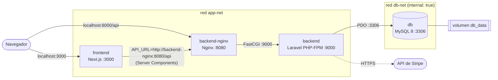

# 🛒 Ecommerce contenerizado: Next.js + Laravel + MySQL

Ecosistema de producción con tres aplicaciones desarrolladas durante el Bootcamp FSJ35, contenerizadas con **Docker** y orquestadas con **Docker Compose**:

| Servicio | Tecnología | Imagen base | Puerto |
|---|---|---|---|
| `frontend` | Next.js 16 (App Router) + React 19 + Stripe | `node:20-alpine` | **3000** (expuesto) |
| `backend-nginx` | Nginx (proxy inverso de la API) | `nginxinc/nginx-unprivileged:1.27-alpine` | **8000** (expuesto) → 8080 |
| `backend` | API REST Laravel 12 + Sanctum + Stripe + Swagger (PHP-FPM) | `php:8.4-fpm-alpine` | 9000 (solo interno) |
| `db` | MySQL 8.0 | `mysql:8.0` (oficial) | 3306 (solo interno) |

Cada imagen propia se construye con **builds multi-stage**. Las herramientas de compilación (Composer, npm, compiladores de C) se quedan en etapas intermedias, y la imagen final contiene solo lo necesario para ejecutar. Todo el ecosistema se levanta con **un solo comando**.

---

## 📁 Estructura del repositorio

```
ecommerce-docker/
├── docker-compose.yml          # Orquestación de los 4 servicios
├── .env.example                # Variables de entorno documentadas
├── frontend/                   # Código fuente Next.js
│   ├── Dockerfile              # Multi-stage: base → deps → builder → runner
│   └── .dockerignore
├── backend/                    # Código fuente API Laravel
│   ├── Dockerfile              # Multi-stage: vendor → php-base → app → nginx
│   ├── .dockerignore
│   └── docker/
│       ├── nginx/default.conf  # Proxy inverso hacia PHP-FPM
│       └── php/
│           ├── opcache.ini     # Rendimiento
│           ├── custom.ini      # Endurecimiento de PHP
│           ├── www.conf        # Pool de PHP-FPM
│           └── entrypoint.sh   # Cachés de Laravel + migraciones al arrancar
└── mysql/
    └── init/01-init.sql        # Script de inicialización (utf8mb4)
```

---

## 🏗 Arquitectura de contenedores



**Flujo de una petición:**

1. El navegador abre el frontend en `localhost:3000`.
2. Los **Server Components** de Next.js llaman a la API con la dirección **interna** `http://backend-nginx:8080/api`. La URL de la API nunca llega al navegador.
3. Nginx reenvía las peticiones `.php` por FastCGI a PHP-FPM (`backend:9000`).
4. Laravel consulta MySQL (`db:3306`) a través de una red interna.

**Aislamiento de redes:**

- **`db-net`** es `internal: true`. MySQL no tiene salida a Internet, y solo el servicio `backend` puede alcanzarlo.
- **`app-net`** conecta frontend, Nginx y backend. El backend está en ambas redes porque necesita MySQL **y** salir a Internet hacia la API de Stripe.
- **Solo dos puertos se publican al host:** `3000` (frontend) y `8000` (API). MySQL (3306) y PHP-FPM (9000) **no se exponen**; se usa `expose`, no `ports`.

**Orden de arranque:** con `depends_on` + `condition: service_healthy`, cada servicio espera a que el anterior pase su *healthcheck*:

```
db (healthy) → backend (healthy) → backend-nginx (healthy) → frontend
```

---

## 🚀 Cómo ejecutar el ecosistema

### Requisitos

- Docker Desktop (Docker 24+ con Compose v2)

### 1. Clonar y configurar variables

```bash
git clone <URL-de-este-repo>
cd ecommerce-docker
cp .env.example .env          # En PowerShell: copy .env.example .env
```

Edita `.env` y completa las contraseñas y las claves de prueba de Stripe.

### 2. Generar la `APP_KEY` de Laravel

```bash
docker compose build backend
docker run --rm --entrypoint php ecommerce-backend:1.0 artisan key:generate --show
```

Copia el valor `base64:...` en `APP_KEY` dentro de `.env`.

### 3. Levantar todo con un solo comando

```bash
docker compose up -d --build
```

Las migraciones se ejecutan automáticamente al arrancar (`RUN_MIGRATIONS=true`). Para cargar productos de ejemplo:

```bash
docker compose exec backend php artisan db:seed --force
```

### 4. Abrir

| URL | Servicio |
|---|---|
| http://localhost:3000 | Tienda (frontend Next.js) |
| http://localhost:8000/api/products | API Laravel |
| http://localhost:8000/api/documentation | Documentación Swagger |

### Comandos útiles

```bash
docker compose ps                    # Estado y healthchecks
docker compose logs -f backend       # Logs de Laravel
docker compose exec backend php artisan route:list --path=api
docker images "ecommerce-*"          # Tamaño de las imágenes
docker compose down                  # Detener (conserva los datos)
docker compose down -v               # Detener y BORRAR la base de datos
```

---

## 🧠 Decisiones técnicas por Dockerfile

### Frontend: `frontend/Dockerfile`

| Etapa | Qué hace | Por qué |
|---|---|---|
| `base` | `node:20-alpine` + `libc6-compat` | Alpine reduce la imagen base de ~1 GB (`node:20`) a ~130 MB. `libc6-compat` permite ejecutar binarios nativos como SWC. |
| `deps` | Copia **solo** `package.json` + `package-lock.json` y ejecuta `npm ci` | **Caché de capas:** si solo cambia el código, esta capa se reutiliza y no se reinstalan dependencias. `npm ci` instala exactamente el lockfile, así que los builds son **reproducibles**. |
| `builder` | `next build` con `output: "standalone"` | Next.js detecta qué archivos de `node_modules` se usan realmente y genera un servidor mínimo. `NEXT_PUBLIC_STRIPE_PUBLISHABLE_KEY` se pasa como `ARG` porque se incrusta en el JavaScript del navegador al compilar. |
| `runner` | Imagen final | Solo copia `.next/standalone`, `.next/static` y `public`. **No incluye** código fuente, TypeScript, Tailwind, devDependencies ni el `node_modules` completo. Corre como usuario sin privilegios `nextjs` (UID 1001) y tiene `HEALTHCHECK`. |

`server.js` es el servidor de producción que genera el modo *standalone*, el equivalente optimizado de `next start`.

`API_URL` **no** se define en el build: se inyecta en **runtime** desde `docker-compose.yml`. Así la misma imagen funciona en cualquier entorno.

### Backend: `backend/Dockerfile` (un Dockerfile, dos imágenes)

| Etapa | Qué hace | Por qué |
|---|---|---|
| `vendor` | `composer:2`. Primero `composer.json`/`composer.lock` → `composer install --no-dev`. Después el código → `dump-autoload --classmap-authoritative`. | Composer y su caché **nunca llegan a producción**. Copiar primero los manifiestos aprovecha la caché: un build sin cambios de dependencias pasó de **82 s a 8.6 s**. `--no-dev` excluye PHPUnit, Faker, Pail, etc. |
| `php-base` | `php:8.4-fpm-alpine` + `pdo_mysql`, `opcache`, `bcmath` | Los compiladores (`$PHPIZE_DEPS`, ~200 MB) se instalan y se **borran en la misma capa `RUN`**, así que no ocupan espacio en la imagen. Un bucle `php -m` **hace fallar el build** si falta alguna extensión requerida (`pdo_mysql`, `mbstring`, `openssl`, `tokenizer`, `xml`, `ctype`, `json`). Usa `php.ini-production` y OPcache. |
| `app` | **Imagen final de la API** | Copia el código (filtrado por `.dockerignore`, sin `.env`) y **únicamente la carpeta `vendor/`** desde la etapa `vendor`. Elimina `tests/` y cachés de desarrollo, ajusta permisos solo en `storage` y `bootstrap/cache` y corre como **`www-data`** (sin root). |
| `nginx` | `nginx-unprivileged` + solo `public/` | **Un proceso por contenedor.** Nginx no necesita PHP ni `vendor/`, solo los archivos públicos, así que la imagen queda en ~74 MB. Corre sin root (puerto 8080), oculta su versión, agrega cabeceras de seguridad y bloquea archivos ocultos (`.env`, `.git`). |

**¿Por qué PHP 8.4 y no 8.2?** El `composer.lock` del proyecto se generó con PHP 8.4, y algunas dependencias exigen `>= 8.4.1`. Con 8.2 el build fallaba, y eso es justo el problema de **inconsistencia entre entornos** que este proyecto busca evitar. La tarea pide PHP **8.2+**, así que 8.4 cumple y además coincide con el entorno de desarrollo.

**Configuración de PHP (`backend/docker/php/`):**

- `opcache.ini`: el código PHP compilado queda en memoria. Usa `validate_timestamps=0` porque el código de una imagen nunca cambia.
- `custom.ini`: `expose_php=Off`, `display_errors=Off` y errores enviados a `stderr` (visibles con `docker compose logs`).
- `www.conf`: `clear_env = no`, para que PHP-FPM pase a Laravel las variables de entorno de Docker.
- `entrypoint.sh`: ejecuta `config:cache`, `route:cache` y `view:cache`, genera Swagger y corre las migraciones **al arrancar** y no en el build, porque las credenciales llegan en runtime. Así la misma imagen sirve para cualquier entorno.

### Base de datos: `mysql:8.0`

- Usa la **imagen oficial, sin Dockerfile propio**: solo se configura, y así recibe los parches de seguridad del mantenedor.
- Credenciales por variables de entorno (`MYSQL_ROOT_PASSWORD`, `MYSQL_DATABASE`, `MYSQL_USER`, `MYSQL_PASSWORD`). La sintaxis `${VAR:?mensaje}` hace que Compose **falle** si falta una variable obligatoria.
- **Volumen persistente** `db_data:/var/lib/mysql`: los datos sobreviven a `docker compose down`.
- **Script de inicialización** `mysql/init/01-init.sql`, montado en `/docker-entrypoint-initdb.d/` en solo lectura. Configura `utf8mb4`.
- Puerto 3306 **no expuesto** al host y red `internal`.

### Seguridad en `docker-compose.yml`

| Medida | Servicios |
|---|---|
| Usuario sin root dentro del contenedor | backend (`www-data`), nginx, frontend (`nextjs`) |
| `cap_drop: [ALL]`, que quita todas las *capabilities* de Linux | backend, backend-nginx, frontend |
| `no-new-privileges`, que impide escalar privilegios | backend, backend-nginx, frontend |
| `read_only: true` + `tmpfs` solo donde se escribe | backend-nginx, frontend |
| Secretos fuera de las imágenes (`.env` en `.gitignore` y `.dockerignore`) | todos |

### Archivos `.dockerignore`

Reducen el *build context* y evitan filtrar secretos. Ejemplo real: el contexto del backend bajó de **1.08 MB a 5 KB**. Además, excluir `bootstrap/cache/*.php` evitó que una caché de desarrollo (que referenciaba `laravel/pail`, una dependencia de dev) rompiera el build de producción.

---

## 📊 Resultados

### Tamaño de las imágenes

| Imagen | Tamaño en disco | Tamaño comprimido (descarga) |
|---|---|---|
| `ecommerce-backend:1.0` | 210 MB | 47.7 MB |
| `ecommerce-nginx:1.0` | 73.7 MB | 21 MB |
| `ecommerce-frontend:1.0` | 262 MB | 64.4 MB |

> Como referencia, solo las imágenes base sin optimizar ya pesan más: `node:20` (Debian) ~1.1 GB y `php:8.4-fpm` (Debian) ~500 MB, sin contar las dependencias.

### Caché de capas

| Build del backend | Tiempo |
|---|---|
| Primero (sin caché) | 82 s |
| Rebuild sin cambios de dependencias | **8.6 s** |
| Ecosistema completo (`docker compose up -d --build`) con caché | **19.7 s** |

---

## 🔐 Variables de entorno

Todas están documentadas en [`.env.example`](.env.example).

| Variable | Uso |
|---|---|
| `MYSQL_ROOT_PASSWORD` | Contraseña de root de MySQL (obligatoria) |
| `MYSQL_DATABASE`, `MYSQL_USER`, `MYSQL_PASSWORD` | Base de datos y usuario de la aplicación |
| `APP_KEY` | Clave de cifrado de Laravel (obligatoria) |
| `APP_NAME`, `APP_ENV`, `APP_DEBUG`, `APP_URL` | Configuración de Laravel |
| `RUN_MIGRATIONS` | `true` ejecuta `migrate --force` al arrancar |
| `STRIPE_KEY` | Clave pública de Stripe (backend y build del frontend) |
| `STRIPE_SECRET` | Clave secreta de Stripe (solo backend) |
| `STRIPE_WEBHOOK_SECRET`, `STRIPE_CURRENCY` | Webhook y moneda de Stripe |
